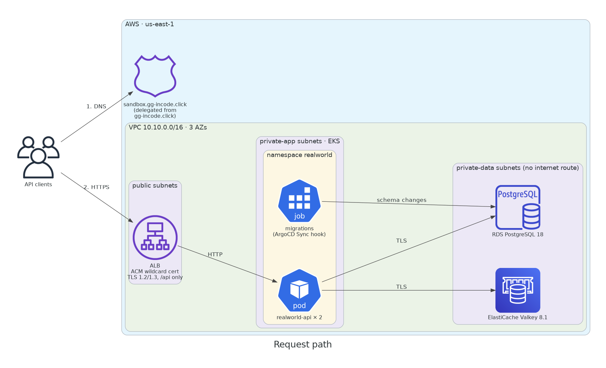
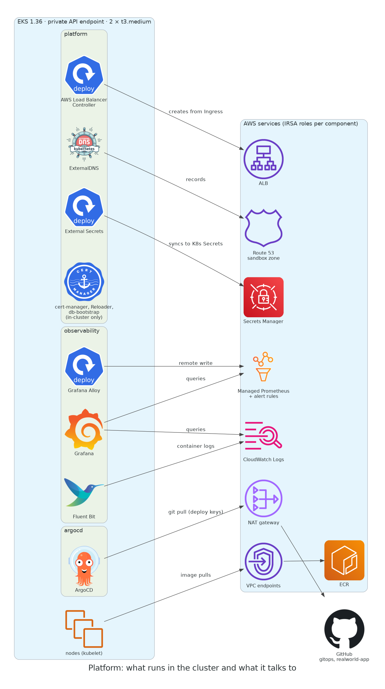
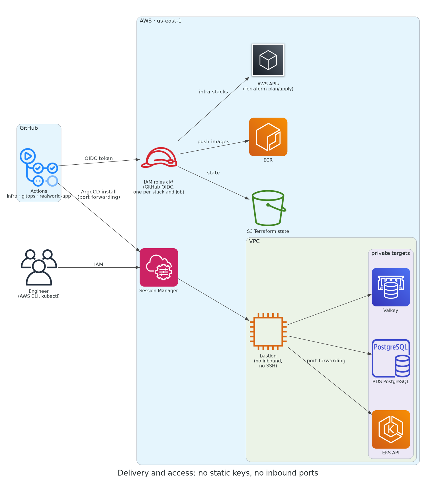
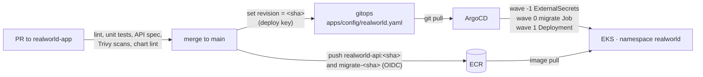
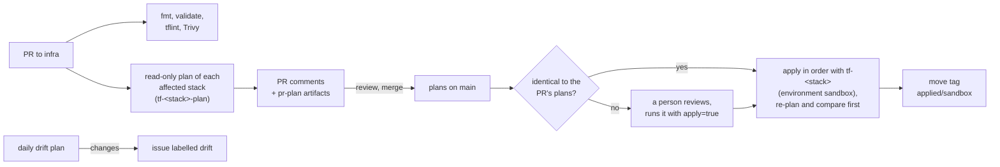
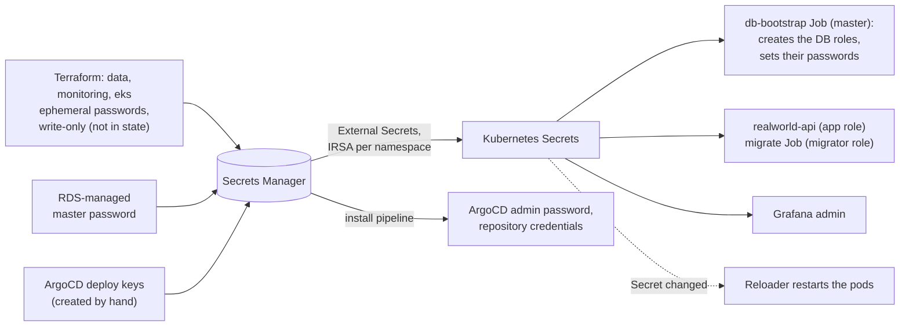

# infra

Terraform for the RealWorld API's sandbox environment on AWS (account 965140467182, us-east-1 only, by organization
policy). It builds the network, an EKS cluster, PostgreSQL and Valkey, observability, DNS and TLS, and the CI that applies
it all. What runs in the cluster lives in [gitops](https://github.com/gabrielguernik/gitops).


## Architecture

Three pictures, one concern each. They are code: [`docs/architecture`](docs/architecture/README.md).

**Request path:** API clients resolve the delegated sandbox zone, then reach the ALB in the public subnets. The ALB
forwards `/api` to the API pods in EKS (private-app subnets), which connect over TLS to PostgreSQL and Valkey in the
private-data subnets (no internet route).



**Platform:** what runs in the cluster and which AWS services it uses. Each component that calls AWS has its own IRSA role.



**Delivery and access:** CI uses GitHub OIDC roles, never static keys. People and the ArgoCD install pipeline reach
private endpoints through Session Manager port forwarding on a bastion with no inbound rules.



**App delivery** (realworld-app CI, gitops, ArgoCD):



**Infrastructure delivery** (this repo; see "CI/CD (Terraform)"):



**Secrets**: generated passwords never enter Terraform state; workloads read them through External Secrets.




## Repositories

| Repo | Contents |
|---|---|
| **infra** (this one) | Terraform for the AWS account and the sandbox environment; Terraform CI/CD |
| [gitops](https://github.com/gabrielguernik/gitops) | ArgoCD install pipeline and everything that runs in the cluster |
| [realworld-app](https://github.com/gabrielguernik/realworld-app) | The API (Node, Express, Prisma), its Helm chart and its CI |

## Stacks

Each stack has its own state, its own CI roles, and publishes its outputs in SSM Parameter Store
(`/<env>/<region>/<stack>/<name>`) for the stacks after it. Apply them in this order:

| # | Stack | Path under `live/` | Contents |
|---|---|---|---|
| 1 | bootstrap | `accounts/sandbox/_global/bootstrap` | State bucket, GitHub OIDC provider, CI roles |
| 2 | shared-global | `shared/_global/shared-global` | Parent zone `gg-incode.click` |
| 3 | shared-regional | `shared/us-east-1/shared-regional` | ECR repo, log archive bucket |
| 4 | account-baseline | `accounts/sandbox/_global/account-baseline` | Account alias, S3 Block Public Access |
| 5 | regional-baseline | `accounts/sandbox/us-east-1/regional-baseline` | EBS encryption by default |
| 6 | dns | `envs/sandbox/_global/dns` | `sandbox.gg-incode.click` zone and delegation |
| 7 | network | `envs/sandbox/us-east-1/network` | VPC, subnets, NAT, VPC endpoints, flow logs |
| 8 | bastion | `envs/sandbox/us-east-1/bastion` | Session Manager bastion (no inbound, no keys) |
| 9 | edge | `envs/sandbox/us-east-1/edge` | Wildcard ACM certificate, ALB security group, optional WAF |
| 10 | eks | `envs/sandbox/us-east-1/eks` | EKS 1.36 (private endpoint), 2 × t3.medium nodes, ArgoCD admin secret |
| 11 | data | `envs/sandbox/us-east-1/data` | RDS PostgreSQL 18, ElastiCache Valkey 8.1, app and DB role secrets |
| 12 | monitoring | `envs/sandbox/us-east-1/monitoring` | Managed Prometheus and alert rules, container log group, Grafana secret |
| 13 | platform | `envs/sandbox/us-east-1/platform` | IRSA roles for the in-cluster components |

Then run the `argocd` workflow in gitops: it installs ArgoCD, which deploys everything else in the cluster.
`live/envs/prod` is a stub showing the prod values of the cost toggles; it is never applied.

Other folders: `modules/` (reusable modules, referenced by relative path), `scripts/tunnel.sh` (port forwarding through
the bastion), `scripts/ci/` (CI logic), `docs/`.

## Working with it

**Change infrastructure:** open a PR. CI checks it (fmt, validate, tflint, Trivy) and posts a read-only plan of each
affected stack. Merging applies those stacks in order, but only if their plans still match the ones reviewed in the PR;
otherwise someone reviews and starts the apply by hand. A daily drift check opens an issue on any difference.
Details: [docs/ci.md](docs/ci.md).

**Run a stack locally** (plain Terraform; providers refuse any account other than 965140467182):

```bash
S=live/envs/sandbox/us-east-1/network
terraform -chdir=$S init && terraform -chdir=$S plan -out=tfplan && terraform -chdir=$S apply tfplan
```

**Reach private endpoints** (Kubernetes API, PostgreSQL, Valkey) through the bastion:

```bash
./scripts/tunnel.sh eks      # localhost:8443  → EKS API
./scripts/tunnel.sh db       # localhost:15432 → PostgreSQL
./scripts/tunnel.sh cache    # localhost:16379 → Valkey
```

[docs/operations.md](docs/operations.md) has the rest: setup from zero, kubectl and psql configuration,
troubleshooting, destroy order and cost (about $360/month), Grafana and the incident runbook.

## Security

- **No static credentials.** CI uses GitHub OIDC roles: a read-only plan role and a write role per stack. Write roles
  trust only the `sandbox` GitHub environment, which only `main` can deploy to. Each role reaches only its own state.
- **No inbound access.** Only the ALB is public. The EKS API, RDS and Valkey are private, reached through Session
  Manager on a bastion with no inbound rules, no public IP and no SSH keys.
- **Secrets stay out of Terraform state.** Generated passwords are ephemeral and written with write-only arguments.
  Pods get them from Secrets Manager through External Secrets. The Valkey auth token is the exception (see below).
- **Least privilege in the cluster.** Each component that calls AWS has its own IRSA role. Pods can't reach the node's
  instance metadata (IMDSv2, hop limit 1). The app's namespace and most platform namespaces
  enforce the restricted Pod Security Standard.
- **Encryption** at rest everywhere (S3, EBS, RDS, ElastiCache) and TLS in transit, ALB to client and pods to data stores.
- **Workloads use dedicated DB roles**, never the RDS master: `realworld_migrator` for migrations, `realworld_app`
  for data access only.

## Observability

| Signal | Where |
|---|---|
| API metrics (latency by route, errors, cache hits, DB pool) and ALB 5xx | Managed Prometheus, via Grafana Alloy |
| AWS metrics (ALB, RDS, Valkey, NAT) | CloudWatch |
| Container logs (JSON, queryable by request ID) | CloudWatch Logs, via Fluent Bit |
| VPC flow logs, ALB access logs | Log archive bucket |
| Dashboards | Grafana in the cluster (private; see operations.md) |

Two alerts, evaluated by Managed Prometheus: **5xx rate above 5%** measured at the load balancer (so it catches
outages the app never sees), and **p95 latency above 500 ms**. Both were verified with injected faults.

## Not implemented

### Required for production

- **One AWS account per environment** (sandbox, staging, prod) under an organization, each with its own state bucket and
  CI roles. Here one account and one region stand in for all of them.
- **Required reviewers** on GitHub environments, a branch ruleset on `main` and CODEOWNERS. This GitHub plan doesn't
  offer required reviewers for private repos, so merging a PR is the approval.
- **Apply the exact reviewed plan file**, instead of re-planning and comparing the list of changes (which checks
  resources and actions, not attribute values).
- **Tighter CI permissions:**
  - a permissions boundary on the IAM roles that `eks`, `bastion` and `platform` create;
  - a custom read policy per stack instead of `ReadOnlyAccess` for plan roles;
  - narrower service actions for `network` and `edge`;
  - `bootstrap` (effectively admin) in a separate management account and pipeline.
- **High availability:**
  - NAT gateway per AZ;
  - RDS Multi-AZ, deletion protection and final snapshot;
  - Valkey replicas;
  - 2+ replicas for every platform controller.

  All but the last are variables in the modules.
- **Autoscaling:** HorizontalPodAutoscaler on the API and Karpenter for nodes. Under load the 2 pods were CPU-bound
  while RDS stayed at 14% CPU.
- **PodDisruptionBudgets**, so a node drain can't evict both API pods at once.
- **NetworkPolicies:** default deny per namespace, with allow-lists. Today any pod can reach any pod.
- **A tested RDS restore,** with a measured RPO and RTO, and snapshot copies to another region or account.
- **Alert delivery:** alert manager to SNS and an on-call tool such as PagerDuty, plus a "dead man's switch". Today
  alerts are only visible in Grafana.
- **Platform alerts and metrics:** nodes, pods, ArgoCD, External Secrets, RDS, Valkey, certificates.
- **Grafana outside the cluster it watches** (Amazon Managed Grafana or a management cluster).
- **Loki as log storage,** shared by all clusters and linked to metrics in Grafana, instead of CloudWatch Logs.
- **Distributed tracing with Tempo:** traces sent through Alloy, and linked to logs (request ID) and metrics in Grafana.
- **Instrumentation outside the application,** with the OpenTelemetry Operator: an `Instrumentation` resource and a pod
  annotation inject Node auto-instrumentation (traces and metrics) at deploy time. The app's in-code metrics move
  out, so every service gets the same telemetry with no code changes or SDK upgrades in each repo.
- **Egress filtering:** AWS Network Firewall or an egress proxy with an allow-list. Today security groups allow
  outbound traffic to anywhere for the bastion, the ALB and the nodes.
- **Customer managed KMS keys** per environment for EKS secrets, S3 (state, log archive), RDS and ElastiCache,
  instead of AWS managed keys.
- **Audit and detection:** CloudTrail, GuardDuty and Security Hub, organization-wide.
- **WAF** on the ALB: the `edge` module supports it (`enable_waf`), off here for cost.
- **Automatic secret rotation** (Secrets Manager rotation with alternating users) and the Valkey auth token out of
  Terraform state (ElastiCache RBAC users). Rotation is a manual procedure today.
- **Human access through IAM Identity Center (SSO)** with short-lived credentials and an account password policy.

### Improvements

- **Canary releases** with Argo Rollouts: traffic split on the ALB, automatic rollback on error rate or latency.
- **An ingress proxy implementing the Gateway API** (Envoy Gateway, for example), for authentication, rate limiting and
  advanced routing in one place.
- **Self-hosted CI runners inside the VPC,** which also removes the bastion from the ArgoCD install path.
- **A GitHub App with short-lived tokens** instead of deploy keys for ArgoCD and CI.
- **A Terraform orchestrator** (Atlantis, Terramate, Spacelift, HCP Terraform) with a dependency graph, so stacks that
  read a changed output are re-planned automatically.
- **Policy as code and cost estimates** on every plan (OPA/Conftest, Infracost).
- **Renovate** for provider, module and action updates; `terraform test` for modules; versioned modules in a registry.
- **Dashboards as code** (Grafana Operator or Grafonnet).
- **Drift alerts** to chat or the on-call tool instead of a GitHub issue.
- **Log archive storage classes** (Standard-IA, then Glacier IR) once volumes justify it, and S3 access logging on the
  bucket itself.
- **No hardcoded AMP workspace ID in gitops,** so recreating `monitoring` needs no gitops commit.
- **A narrower Load Balancer Controller policy:** the vendored upstream one allows security group changes the
  controller never makes here.

The designs for these are in [docs/production.md](docs/production.md).
